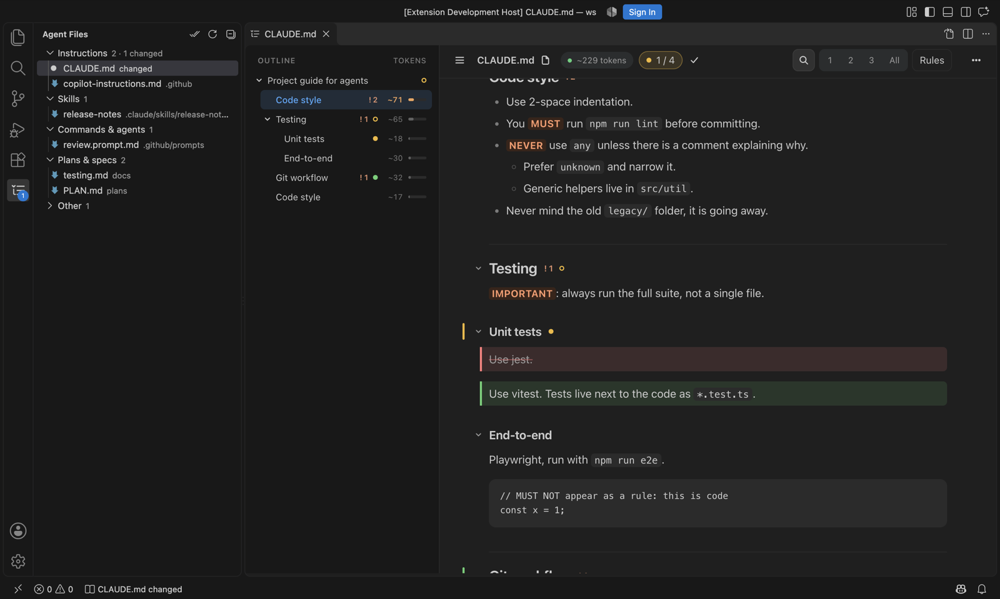

# mdr — a reader for agent markdown

A read-only reader for the markdown files agents live on: `CLAUDE.md`, `AGENTS.md`, `SKILL.md`, slash commands, plans and specs. It turns a file into a **foldable tree** so you can read only the parts you care about, and shows **what changed since you last read it**, which helps when an agent rewrites the file while you're away.



## Get started

Pick the way that fits how you work. They all show files the same way.

| You want to… | Use | Start |
|---|---|---|
| Try it right now, or read a file someone sent you | **Web page** | Open https://mohitrangwani11.github.io/mdr-reader/ and paste or drop a `.md` file. Nothing to install. |
| Read your project's agent files while you code | **VS Code extension** | Download the `.vsix` from the [latest release](https://github.com/mohitrangwani11/mdr-reader/releases/latest), then `code --install-extension mdr-reader-<version>.vsix`. Click the mdr icon in the activity bar. |
| Watch files live while an agent edits them, from the terminal | **CLI** | See [Live mode](#live-mode-cli) below. |

## How to use it

A first read of a `CLAUDE.md` (or any agent file) takes about a minute:

1. **Open the file.** On the web page, paste it (⌘V / Ctrl+V) or drop it on the page. In VS Code, click it in **Agent Files**, or press `⌘⌥M` / `Ctrl+Alt+M` on an open markdown file.
2. **Get the outline.** Press `1` to fold everything to top-level sections, so the file reads like a table of contents. The outline on the left shows how many tokens each section costs, and the heaviest one is amber.
3. **Open only what you need.** Click a heading to unfold it. Press `/` to filter sections by a word. Press `f` to focus on one section and hide the rest (`Esc` brings everything back).
4. **See what the agent is told to do.** Press `r` to show only the rules: the `MUST`, `NEVER`, `ALWAYS` and `IMPORTANT` lines.
5. **Come back later and see what changed.** When the file changes (an agent rewrote it, or a teammate edited it), the changes are highlighted: added in green, changed in amber, removed in red and struck through. Press `n` to jump from one change to the next.
6. **Mark it read.** Press `m` when you're done. The next time you open it, you'll only see what changed after that.
7. **Send a section back to the agent.** Press `c` to copy the current section as markdown and paste it into your agent with "fix only this part". On the web page, **Share** copies a link that contains the whole doc.

Press `?` anytime to see every shortcut.

### Keyboard shortcuts

| Key | Does |
|---|---|
| `1`–`6` / `0` | Fold to that heading level / unfold everything |
| `/` | Filter sections |
| `f` / `Esc` | Focus the current section / show everything again |
| `r` | Rules only |
| `n` / `N` | Next / previous change |
| `m` | Mark as read |
| `c` | Copy the current section as markdown |
| `o` | Show or hide the file sidebar |
| `t` | Theme: auto / light / dark (the VS Code tab follows your VS Code theme instead) |
| `e` | Edit the source beside the reader (VS Code) |
| `u` / `v` | Reload a linked file / paste a new version (web page) |
| `?` | All shortcuts |

### Bringing it to your team

- **Send the link.** The web page needs no install or account, so https://mohitrangwani11.github.io/mdr-reader/ is the easiest way to start. Docs stay in each person's browser.
- **Share a doc, not a file.** **Share** on the web page copies a link with the document inside it, so a reviewer can open a plan or spec in mdr with one click.
- **Point to it from your project.** Add a line to your project's README or `CLAUDE.md`, for example: *"To read the agent files, use [mdr](https://github.com/mohitrangwani11/mdr-reader)."*
- **Install the extension for the team.** Post the `.vsix` link from the [latest release](https://github.com/mohitrangwani11/mdr-reader/releases/latest) with the one-line install command above.

## Web page (no install)

**Use it online:** https://mohitrangwani11.github.io/mdr-reader/ (rebuilt from `main` on every push). Everything stays in your browser; nothing is uploaded.

Or open **`dist/mdr.html`** in any browser: double-click it, send it to someone, or put it on any static host. It's a single self-contained file with no server, and nothing is uploaded.

- **Paste** markdown anywhere on the page (⌘V / Ctrl+V), **drop** `.md` files, or click **+ New**: one dialog takes pasted text, dropped files or **Choose files…**
- **New version** (`v`, in the ⋯ menu): paste or drop an updated copy of a doc to see exactly what changed. Dropping a file with the same name does the same.
- **Share:** copies a link that contains the doc itself, compressed into the URL fragment. No server ever sees it.
- **Linked files** (Chrome, Edge): a file you choose or drop stays linked to the file on disk (🔗 in the sidebar). Press **↻** next to its name (`u`) to pull in your edits with the changes highlighted. Linked files are also checked whenever you come back to the tab. In Safari and Firefox, Reload asks you to pick the file again.
- Docs are saved in this browser (localStorage), and relaunching reopens the doc you were reading. Remove one with the × in the sidebar.

To build it: `npm install && npm run web` (builds and opens `dist/mdr.html`; `dist/` is not committed).

## VS Code extension

**Install:** download `mdr-reader-<version>.vsix` from the [latest release](https://github.com/mohitrangwani11/mdr-reader/releases/latest), then run `code --install-extension mdr-reader-<version>.vsix` (or in VS Code: Extensions → ⋯ → Install from VSIX…). Reload VS Code afterwards.

- **The mdr icon in the activity bar** opens **Agent Files**, the workspace's agent files grouped by kind. A count badge and amber dots show what changed since you last read it.
- **Click a file** to open the reader in an editor tab, landing on the first change. It follows your VS Code theme.
- **Other ways in:** **Open in mdr** on any markdown file (editor title bar, or right-click), `⌘⌥M` / `Ctrl+Alt+M`, and a status bar item when something changed.
- **GitHub Copilot agent mode:** read-only tools `#mdrFiles`, `#mdrOpen`, `#mdrChanges` and `#mdrOutline`. Ask "what changed in CLAUDE.md since I last read it?" or "open the plan in mdr".
- Last-read snapshots are shared with the CLI (`~/.mdr`).

To build it yourself: `npm run vsix`, which writes `dist/mdr-reader-<version>.vsix`.

## Live mode (CLI)

For files that agents keep rewriting: it watches the disk and updates as they change.

It isn't on npm yet, so install it from this repo (needs Node 20+):

```sh
git clone https://github.com/mohitrangwani11/mdr-reader.git
cd mdr-reader
npm install && npm run build
npm link -w packages/cli             # adds a global `mdr` command
```

Then, from any project:

```sh
mdr .                  # a folder: finds the agent files and opens the reader in your browser
mdr path/to/CLAUDE.md  # one file
```

Without `npm link`, run it from the repo with `npm run mdr -- path/to/project`.

Options: `--port <n>` (default 4711), `--all` (expand "Other markdown"), `--no-open`.

## What it does

- **Fold anything:** headings, nested lists, long code blocks, big tables, and YAML frontmatter (shown as a card).
- **Fold to level** with `1` `2` `3` (a lone title heading is skipped). `0` unfolds everything.
- **Focus** (`f` or ◎): show only the sections you pick. `Esc` shows everything again.
- **Filter** (`/`): narrow the tree to the sections that match.
- **Rules** (`r`): highlights `MUST` / `NEVER` / `ALWAYS` / `IMPORTANT` / `DO NOT`… (caps only, never inside code), with a rules-only view.
- **Checklist progress** per section, rolled up the tree.
- **Copy section** (⧉ or `c`): copies a section and its subsections as markdown, ready to paste back to an agent.
- **Token estimates** per section (outline) and for the whole file (top bar). This is a rough estimate (~4 characters per token).
- **@imports** (`@docs/testing.md`) expand inline. Cycles are detected and nesting stops at 5 levels.
- **Live reload with diff since last read:** added, changed and removed blocks are highlighted. Folded sections still show a change dot. Press `n` for the next change and `m` to mark the file as read.
- **Folder mode** groups files into Instructions, Skills, Commands & agents, Plans & specs, Memory and Other, with an unread dot on each changed file. GitHub Copilot's files are recognised too (`.github/copilot-instructions.md`, `*.instructions.md`, `*.prompt.md`, `*.chatmode.md`, `*.agent.md`).
- **Token weight:** each outline row has a bar for its share of the file. The section that dominates the budget is amber. The top bar shows tokens *visible now* / whole file, so you know what you'd be sending.
- Fold, focus and open-import state are remembered per file. **Theme:** in the ⋯ menu, or `t` to cycle Auto (follows the OS), Light and Dark. Works at widget size (~400px wide).

State lives in `~/.mdr` (last-read snapshots plus view state). Set `MDR_HOME` to move it.

## Use cases

| Who | Job | How |
|---|---|---|
| Developer using agents | Review the plan an agent proposes before approving it | Fold, focus (`f`), checklist progress |
| | The agent revised the plan: what changed? | **New version** → diff, `n` to step through changes |
| Tech lead | Audit a CLAUDE.md: what is the agent *forced* to do? | Rules only (`r`), rule counts per section |
| | Vet a third-party SKILL.md before installing it | Frontmatter card (name, description, allowed-tools) |
| PM / non-engineer | Skim a long agent-written report or spec | `1` = table of contents, filter (`/`) |
| | Send a spec to someone | **Share** link |
| Prompt / platform engineer | Keep instruction files lean | Token estimate per section |
| Anyone | "Fix only *this* section" | Copy section → paste to the agent |

## Architecture

```
packages/core   the reader: parse → section tree → render → interactions. No disk access.
packages/cli    Live mode host: discovery, file watching (chokidar), HTTP + SSE on 127.0.0.1, ~/.mdr store
packages/web    Paste edition host: docs in localStorage, paste / drop / open, share links → dist/mdr.html
packages/vscode VS Code host: Agent Files view, reader webview (postMessage RPC), Copilot agent tools
```

The `Host` interface (`packages/core/src/host.ts`) is the only seam between the reader and the outside world. The VS Code extension is one more host with the same core. It reuses the CLI's workspace layer (`packages/cli/src/workspace.ts`) with VS Code's file watcher.

Security: the server binds to 127.0.0.1 only and rejects foreign `Host` headers. The API needs a per-run token. It serves only markdown inside the opened folder, plus files that an open file explicitly `@imports`.

## Develop

```sh
npm test            # vitest: core model + server integration
npm run typecheck
npm run build
```

## Roadmap

- **Next:** memory files (backlinks, link graph), and publishing the extension to the VS Code Marketplace and Open VSX.
- **Backlog:** item-level diffs inside lists (today a changed list shows as removed + added), flagging risky `allowed-tools` in skills, comparing two docs side by side, exporting the focused view, publishing the CLI to npm (`npx mdr`).

## License

[MIT](LICENSE)
