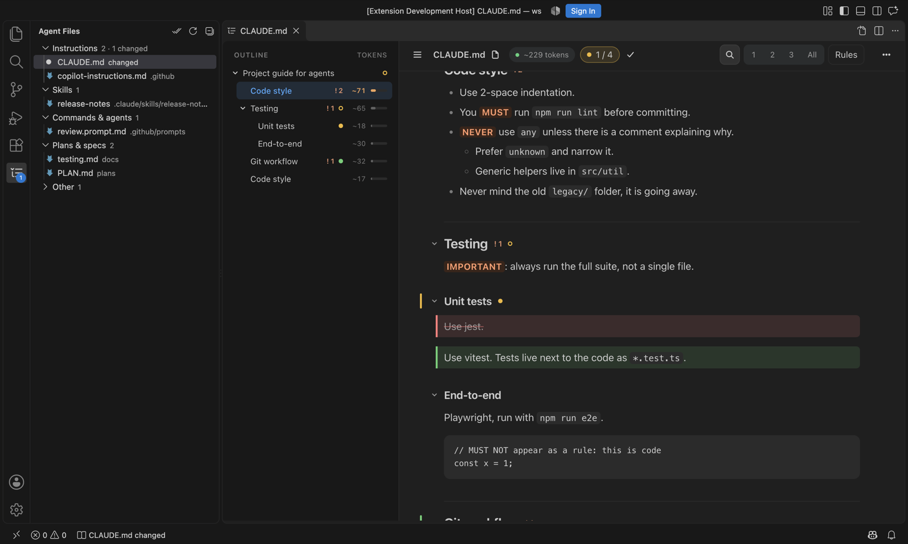

# mdr — Agent Markdown Reader

Read the markdown your agents live on (`CLAUDE.md`, `AGENTS.md`, Copilot instructions, prompts, skills, plans and specs) as a **foldable tree**, and see **what changed since you last read it**.

## Where to find it

- **The mdr icon in the activity bar** opens **Agent Files**: every agent file in the workspace, grouped into Instructions, Skills, Commands & agents, Plans & specs, Memory and Other. When a file changed since you last read it, the icon shows a count and the file shows an amber dot.
- **Click a file** to open it in the reader tab. If it changed, you land on the first change, with added, changed and removed text highlighted.
- **Status bar:** when something changed, a quiet item says so ("CLAUDE.md changed"). Click it to see the changes.
- **On any markdown file:** use the **Open in mdr** button in the editor title bar, or right-click → **Open in mdr**.
- **Keyboard:** `⌘⌥M` (macOS) or `Ctrl+Alt+M` opens the reader on the current markdown file, or on the last one you read.

## In the reader

| Key | |
|---|---|
| `1` `2` `3` / `0` | Fold to level / unfold all |
| `/` | Filter sections |
| `r` | Rules only (MUST, NEVER, ALWAYS, IMPORTANT, DO NOT…) |
| `f` | Focus on the current section |
| `c` | Copy the section as markdown, ready to paste back to an agent |
| `n` / `m` | Next change / mark as read |
| `e` | Edit the source beside the reader |
| `?` | All shortcuts |

The outline shows each section's share of the file's tokens, so you can see what dominates your context budget. `@imports` expand inline. The reader follows your VS Code theme.

## With GitHub Copilot agent mode

mdr gives Copilot's agent four read-only tools. Ask in plain words, or reference them with `#`:

- **`#mdrFiles`** lists the agent files and which ones changed.
- **`#mdrOpen`** opens a file in the reader, at a section or at its first change. Try "open the plan in mdr".
- **`#mdrChanges`** shows what changed since you last read the file. Try "what changed in CLAUDE.md since I last read it?"
- **`#mdrOutline`** gives the outline with token counts and checklist progress, or just the rules. Try "what does CLAUDE.md require?"

When the agent edits a file you have open, the reader updates live with the changes highlighted.

## Settings

- `mdr.showAllMarkdown`: expand the "Other" group (non-agent markdown). Off by default.
- `mdr.statusBar`: `changes` (default) or `never`.

Last-read snapshots live in `~/.mdr` (set `MDR_HOME` to move them) and are shared with the `mdr` CLI. Nothing leaves your machine.

## License

MIT
